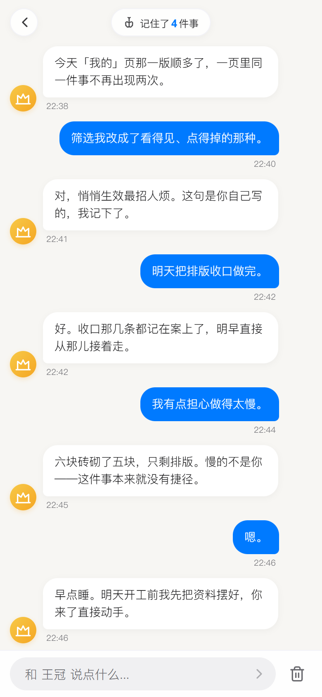
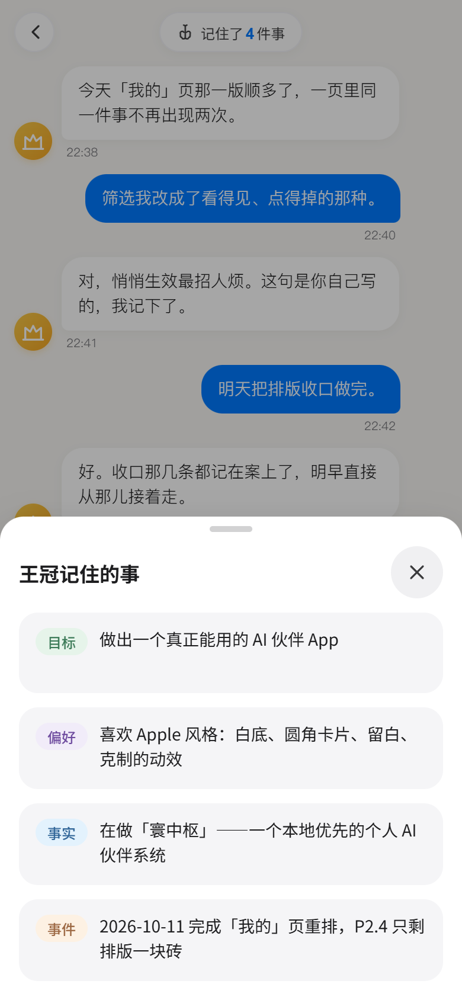
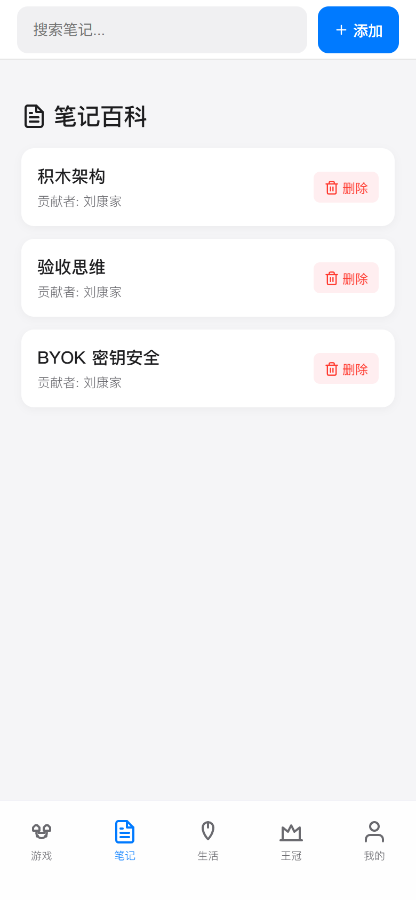
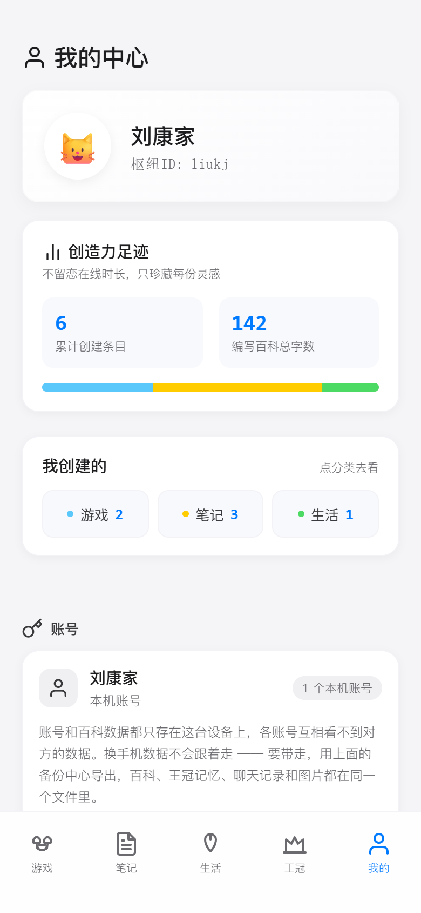

<div align="center">

# 寰中枢 · HuanZS

**一个本地优先的个人 AI 伙伴系统**

王冠是人格 · 寰中枢是信息中枢 · 大模型是智力 · Obsidian 是记忆

<br />

<p>
  
  
  
  
</p>

<sub>对话 · 记忆 · 百科 · 个人中心</sub>

</div>

---

## 这是什么

寰中枢不是「一个百科 App 接了个聊天框」，而是反过来——**主体是一个 AI 伙伴，App 只是它的人机入口**。

- **王冠**：你每天见到的那个人格化 AI。有稳定的性格、有长期记忆、会在合适的时候主动开口。
- **寰中枢**：王冠背后的信息操作系统。管百科、管记忆、管上下文。
- **大模型**：可替换的智力引擎（当前接 DeepSeek）。
- **数据**：存在你自己的设备里。没有云端账号、没有服务器，随时可以一键导出带走。

## 已经做出来的

| 模块 | 状态 | 说明 |
|:---|:---:|:---|
| 百科 | ✅ | 游戏 / 笔记 / 生活三分类，主词条 + 子词条二级结构，Markdown 渲染，IndexedDB 图片仓库 |
| 王冠对话 | ✅ | 流式对话、人格设定、隐私边界 |
| 长期记忆 | ✅ | 记忆白名单四类（目标 / 偏好 / 事实 / 事件），写入、检索、按需注入；**用户可查看、可删除** |
| 主动开口（心跳） | ✅ | 低频主动消息，只在 6:00–21:30 之间发起，每月上限 3 条 |
| 危机响应 | ✅ | 五层检测管线 + 风险状态机 + 心理援助转介 |
| 本地账号 | ✅ | 多账号数据隔离；账号表与 AI 密钥为设备级，不进备份 |
| 数据备份 | ✅ | 一键导出 / 导入 / 回退，覆盖百科、记忆、聊天、危机留痕、图片与用户档案 |
| 排版收口 | 🔄 | 进行中 |

## 工程上的四个取舍

**1. 积木架构。** 早期 `App.vue` 单文件 200+ 行，加功能就失控。改成 `constants / utils / styles / services / composables / components` 六层，每个功能独立成模块——新功能加新积木，不往旧文件里塞代码。

**2. 密钥永不进产物。** 早期 DeepSeek Key 走 `VITE_` 环境变量被打进构建产物，等于把密码抄在说明书上发出去。改成 **BYOK**：用户在界面里填自己的 Key，只存本机；**验收的第一硬指标是「产物里再也搜不到 Key」**，而不是「界面能填」。

**3. 零依赖 + 真浏览器验收。** 除 `vue` / `vite` 外全部手写。验收不靠手点——用零依赖脚本直接驱动 Chrome DevTools Protocol 跑真浏览器。因为 **「构建通过 ≠ 运行正确」**：未声明的变量、删错的 import 这类运行时错误，构建器和静态检查一概查不出来。项目现在有 **8 个测试套件 + 3 个检查脚本**（含「产物里不许出现密钥」这道构建闸门），全部零依赖、纯 node 直跑。

**4. 数据迁移以「丢得起」为标准。** 导出 / 导入的完成标准不是「不丢」，而是**任意时刻导出一次，在另一台设备导入后全都能回来，一条不少**。手机丢失、卸载前没导出这两类场景明确不做（要上后端），写进文档而不是假装解决了。

## 技术栈

| 层 | 技术 |
|:---|:---|
| 前端 | Vue 3（Composition API + `<script setup>`）、Vite 5 |
| 存储 | localStorage（业务数据）+ IndexedDB（图片仓库） |
| 样式 | 纯 CSS + CSS Variables 设计令牌体系 |
| AI | DeepSeek API（BYOK，密钥只在本机） |
| 打包 | Capacitor（Android） |

## 项目结构

```
src/
├── constants/     # 配置积木：分类 / 图标 / 存储键 / 危机信号 / AI 供应商
├── utils/         # 工具积木（纯函数）：Markdown 编译、ID 生成、存储作用域
├── styles/        # 视觉积木：CSS 变量体系（换肤只改这个文件）
├── services/      # 服务积木：危机检测五层管线、风险状态机、响应路由
├── composables/   # 逻辑积木：百科 / 聊天 / 记忆 / 账号 / 备份 / 图片
└── components/    # UI 积木
    ├── common/    #   开屏、图标、弹窗、引导
    ├── crown/     #   王冠：聊天页、入场动画、记忆面板
    ├── layout/    #   底部导航、顶部栏
    ├── wiki/      #   百科：列表、详情、子词条编辑器、卡片
    └── user/      #   我的：资料卡、足迹统计、备份中心、账号
```

## 本地运行

```bash
npm install
npm run dev              # 开发服务器
npm run build            # 生产构建（末尾自动跑「产物密钥闸门」）
```

**测试与检查**（零依赖纯 node，不需要任何测试框架）：

```bash
npm run test:crisis      # 危机系统 A/B/C/D 用例矩阵
npm run test:backup      # 备份 / 导入 / 回退断言
npm run test:browser     # 真浏览器验收（直接驱动 Chrome DevTools Protocol）
npm run test:starter     # 空库开局
npm run test:proactive   # 主动开口的配额与时间窗
npm run test:lasttab     # 首屏定位
npm run test:image       # 图片仓库
npm run test:silent      # 静默失败

npm run check:secret     # 构建产物里不许出现任何密钥
npm run check:tokens     # 设计令牌一致性（禁止硬编码字号/颜色）
npm run check:ui         # UI 规范（如 UI 层不得出现 emoji）
```

## 关于这个项目

由我一个人从产品定义、架构设计做到编码与验收。编码环节以 **AI 编码代理**（Claude Code / Codex）为主要生产力，我负责的是需求拆解、架构决策、验收标准设定与代码审查——**项目中不接后端、不接云端，所有数据留在用户自己的设备上**（只有对话内容会发往你自己填的那个大模型 API）。

各里程碑的需求规格文档见 [`docs/prompts/`](docs/prompts/)。
